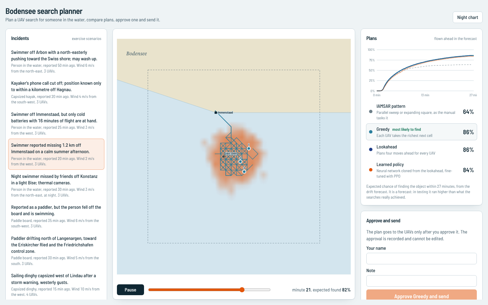

# bodensee-sar-autonomy

**Planning a drone search for a person in the water on Lake Constance.** A C++ simulation of
drift and detection, search planners from the IAMSAR manual to deep reinforcement learning
(Ray RLlib on Kubernetes), a safety shield no planner can override, MAVLink to the autopilots,
DIS to other simulators, and a console where a coordinator compares plans and approves one.

The question it answers is the one a water-rescue coordinator faces: *someone went into the
lake 30 minutes ago near here, the wind is from the south-west, I have three drones with 30
minutes of battery. Where do I send them, so we are most likely to find the person in time?*



## What is in it

| Part | What it does |
|---|---|
| **Simulation core** (`cpp/`, C++20, nanobind) | Lake Constance from 41 shore points (478 km² against the real 473 km²), three no-fly zones (Friedrichshafen and Altenrhein airports, Eriskircher Ried), eight launch sites. A Monte Carlo drift forecast (2048 particles, leeway by object type, wind and current errors, beaching) is the **belief**; one object drifting with the real wind and gusts is the **truth**. About 9,000 steps per second per core. |
| **Sensor model** (`sar.perception`, OpenCV) | Synthetic daylight and thermal frames of a pass (waves, whitecaps, glint, off-nadir blur), an OpenCV detector, and its measured lateral range curves and sweep widths per object, camera and wind (`config/sensor_calibration.yaml`). The planner uses the sweep width; the truth uses the whole curve. |
| **Safety shield** (C++) | Every move is checked: inside the search area, outside no-fly zones, battery enough to fly home with a 3-minute reserve. Planners and the policy get its mask; the simulator enforces it anyway. |
| **Planners** | IAMSAR parallel sweep / expanding square (what the manual tasks), greedy, a four-move lookahead per UAV, and a learned policy. |
| **Learning** (`sar.train`) | Multi-agent PPO on Ray RLlib's new API stack, one network shared by all UAVs, action masking in a custom RLModule, an imitation start (lookahead + DAgger), MLflow tracking, ONNX export served with ONNX Runtime. |
| **Interfaces** (`sar.interop`) | MAVLink v2 mission upload with retransmission (checked against pymavlink, survives 35% packet loss); DIS v7 Entity State PDUs, byte-identical to Open-DIS; a rescue boat from another simulator joins the search. |
| **Console and API** (`console/`, `sar.api`) | React 19, Vite, Tailwind v4, Motion. FastAPI. Plans flown ahead in the forecast, compared by expected success over time; a named person approves one (append-only); it is uploaded to every UAV; an exercise debrief shows the truth afterwards. |
| **Platform** (`docker/`, `deploy/k8s/`, `.github/`) | Images for the API and for training; KubeRay RayJobs for training and evaluation; CI runs the C++ tests under sanitizers, Python and console tests, Playwright in a browser, the dev evaluation (diffed), and a real RayJob on a kind cluster. |

## Results

Every planner flies the same scenarios with the same seeds, so they face the same truth and the
differences are paired. "Found" means a camera really detected the object (truth) within the
search time. Confidence intervals are stratified bootstrap (2000 resamples).

### Development scenarios (12 incidents x 40 seeds)

RESULTS_DEV

### Blind held-out set (20 incidents x 40 seeds, first and only run)

RESULTS_BLIND

### What the numbers say

RESULTS_TEXT

## Run it

```bash
python3.12 -m venv .venv
.venv/bin/pip install -e ".[serve,train,interop,dev]" -c constraints.txt --extra-index-url https://download.pytorch.org/whl/cpu
(cd console && npm ci && npm run build)
SAR_DEMO_VEHICLES=1 .venv/bin/sar serve          # http://127.0.0.1:8000, with four stand-in autopilots
```

```bash
.venv/bin/sar evaluate --set scenarios/dev       # compare planners; writes reports/evaluation/dev.*
.venv/bin/sar train --start imitation            # Ray RLlib; MLflow in ./mlflow.db; models/policy.onnx
.venv/bin/sar calibrate                          # re-measure the detector (about 11 minutes)
.venv/bin/sar bench
```

On Kubernetes (any cluster with the KubeRay operator):

```bash
docker build -f docker/Dockerfile.train -t bodensee-sar-train:ci .
docker build -f docker/Dockerfile.api -t bodensee-sar-api:ci .
kubectl apply -k deploy/k8s                      # API + a training RayJob
kubectl apply -f deploy/k8s/rayjob-evaluate.yaml # evaluation fanned out as Ray tasks
```

Real autopilots: `SAR_VEHICLES=10.0.0.11:14550,10.0.0.12:14550 sar serve`.

## Tests

| Suite | What it covers |
|---|---|
| C++ (Catch2, 27 cases, ASan + UBSan, warnings as errors) | geometry, reproducible random numbers, belief update arithmetic, truth isolation, shield under a reckless policy, beaching, external searchers, planners, MAVLink framing and resynchronisation, DIS round trip |
| Python (pytest) | scenario validation, lake area against the real lake, calibration sanity, truth isolation (code scan and poisoned truth for every planner), planners and their ranking, MAVLink against pymavlink both ways, upload under packet loss, DIS against Open-DIS, a boat over UDP joining the search, perception, the RLlib environment contract, the masked RLModule, ONNX parity, statistics, reproducible evaluation, the API end to end with uploads |
| RLlib smoke | builds and trains PPO for two iterations and exports ONNX |
| Console (Vitest) | loading, error with retry, empty states, plan comparison, wording, projection |
| Browser (Playwright) | choose an incident, compare plans, approve, uploads to four autopilots, debrief, night chart |
| Kubernetes (CI, kind) | the API deployment becomes ready and answers; the training RayJob succeeds on KubeRay |

## Limits

- **Simulated.** The lake outline, airspace circles, leeway coefficients, forecast errors and
  the camera scenes are approximations chosen to be plausible, not operational data. Nothing
  here is fit for real rescue use.
- The planners do not model false alarms, the drones' climb and transit, wind on the drones,
  or communication range.
- MAVLink and DIS are checked against reference implementations and a stand-in autopilot, not
  against a real vehicle or a live DIS exercise.
- Training ran on two CPU cores. See ADR 0003 and `reports/training/` for what PPO achieved
  from scratch and from the imitation start.

## Documentation

`docs/ARCHITECTURE.md`, `docs/adr/` (belief and truth, the C++ core, learning, interfaces),
`AGENTS.md` (invariants and the held-out rule), `heldout/WRITING_SCENARIOS.md` (the guide the
blind set was written from).
